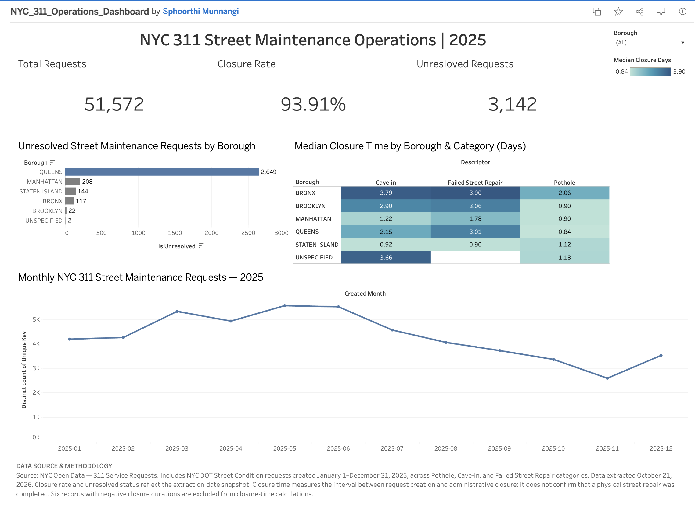

# NYC 311 Street Maintenance Operations Analysis

## Project Overview

An end-to-end data analytics and business analysis project examining
New York City 311 street maintenance service requests.

The project investigates operational workloads, administrative closure
times, geographic patterns, and opportunities for process improvement.

## Interactive Tableau Dashboard

[**Explore the interactive NYC 311 Operations Dashboard on Tableau Public**](https://public.tableau.com/views/NYC_311_Operations_Dashboard/NYC311OperationsDashboard)

The dashboard includes three operational KPIs, unresolved requests by borough, median administrative closure times, monthly request trends, and an interactive borough filter.

## Business Insights & Recommendations

The analysis identifies geographic differences in unresolved requests,
variations in administrative closure times, and opportunities for
operational performance monitoring.

Key recommendations include investigating the concentration of
unresolved requests in Queens, reviewing longer closure times for
specific complaint categories, and establishing consistent KPI monitoring.

**[Read the Business Insights & Recommendations Report](docs/business_insights.md)**

The report includes an executive summary, detailed operational findings,
business implications, five recommendations, and suggested success measures.

## Business Problem

How can NYC street maintenance operations teams use service-request
data to identify potential bottlenecks, monitor workloads, and
prioritize operational improvements?

This is an independent portfolio case study, not an official NYC
Department of Transportation analysis.

## Project Scope

- **Period:** January 1 – December 31, 2025
- **Agency:** NYC Department of Transportation (DOT)
- **Complaint category:** Street Condition
- **Request types:** Pothole, Failed Street Repair, Cave-in
- **Geography:** All five NYC boroughs

## Dataset Summary

This analysis includes 51,572 NYC 311 Street Condition service requests
created between January 1 and December 31, 2025.

The dataset was extracted on October 21, 2026, and includes three
request categories:

| Request Type | Requests | Share |
|---|---:|---:|
| Pothole | 38,438 | 74.53% |
| Cave-in | 9,647 | 18.71% |
| Failed Street Repair | 3,487 | 6.76% |
| **Total** | **51,572** | **100%** |

### Data Quality and Validation

Python scripts were used to extract, validate, and clean the data.

The final dataset contains 51,572 unique requests.

Six records with negative closure durations were excluded from
closure-time calculations.

Request statuses reflect the October 21, 2026 extraction snapshot,
not necessarily their status at the end of 2025.

Administrative closure does not confirm that physical street repairs
were completed.

## Tools & Technologies

- **Python:** Data extraction, validation, cleaning, and operational analysis
- **SQL (SQLite):** KPI calculations, request category analysis,
  borough comparisons, and monthly trends
- **Tableau Public:** Interactive dashboard with operational KPIs,
  borough filtering, and visual analysis
- **Git & GitHub:** Version control, project documentation, and portfolio presentation

## Project Deliverables

1. **Data Extraction:** Reproducible Python script to retrieve NYC 311
   Street Condition requests.
2. **Data Validation & Cleaning:** Python scripts to identify data
   quality issues and prepare the analytical dataset.
3. **KPI Definitions:** Documented operational metrics and calculation rules.
4. **SQL Analysis:** Queries examining closure rates, request categories,
   borough-level performance, and monthly trends.
5. **Python Analysis:** Additional operational analysis and visualizations.
6. **Interactive Tableau Dashboard:** Published dashboard featuring
   KPIs, unresolved requests by borough, closure-time comparisons,
   and monthly request trends.

## Key Findings

- **51,572 requests** were created during 2025 across the three
  selected street maintenance categories.
- **93.91%** were administratively closed as of October 21, 2026.
- **3,142 requests** remained unresolved at the extraction snapshot.
- **Queens accounted for approximately 84.3%** of unresolved requests.
- **0.99 days** was the median administrative closure time among
  records with valid closure durations.
- **May had the highest request volume**, with 5,558 requests.

These findings describe administrative request processing.
They do not establish whether physical street repairs were completed.

## Data Source

NYC Open Data — 311 Service Requests from 2020 to Present

https://data.cityofnewyork.us/d/erm2-nwe9

## Project Status

**Technical analysis and interactive dashboard completed.**

- Data extraction, validation, and cleaning: Complete
- SQL analysis and KPI definitions: Complete
- Python operational analysis: Complete
- Tableau dashboard: Published
- Business insights and recommendations: In progress
- Portfolio website integration: Pending

The analysis uses NYC 311 requests created during 2025,
with administrative statuses observed as of October 21, 2026.